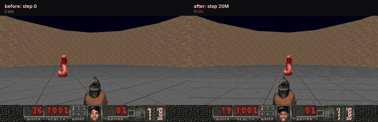
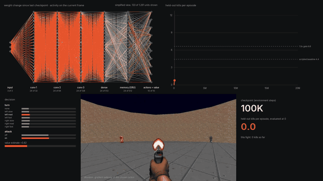
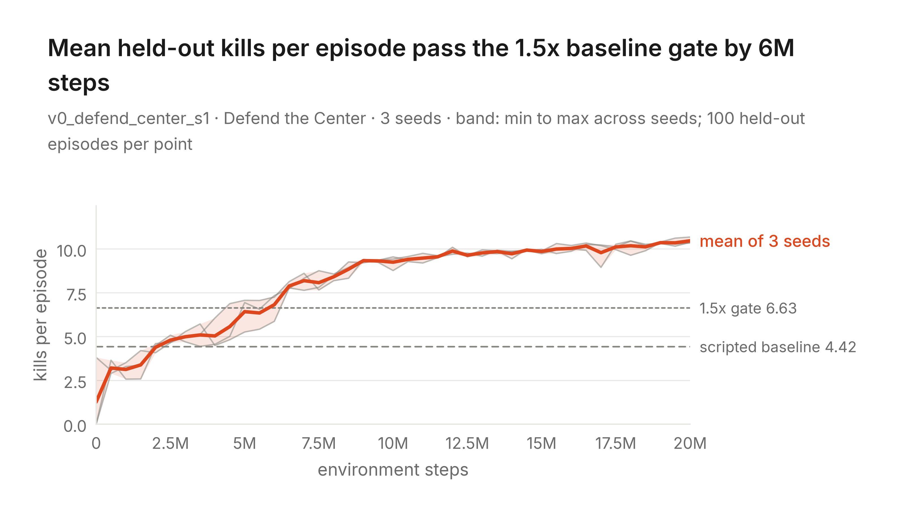
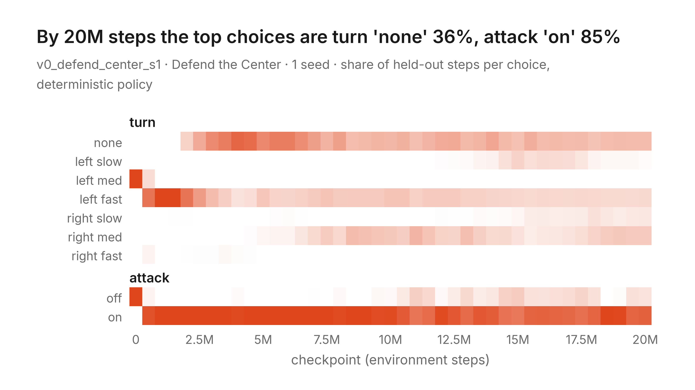
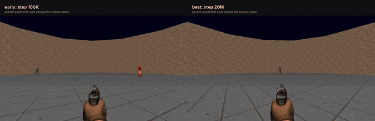

# Gradient Doomscent

**An AI that teaches itself to fight in Doom from raw pixels, trained on a laptop CPU, with a built-in camera crew that films it learning.**

[](https://github.com/YashDThapliyal/gradient-doomscent/actions/workflows/ci.yml)


[](LICENSE)

<p align="center">
  
  <br>
  <em>Same game, same 26 bullets. Left: the untrained network (0 kills). Right: after 20M steps of practice (11 kills).</em>
</p>

## TL;DR

- **Pixels in, joystick out.** The agent sees a 128x72 image of the screen. Nobody tells it what a monster is, what the gun does, or where to aim. It gets points for kills and loses points for dying.
- **It reinvented the obvious trick, then outgrew it.** In every run, it first discovered "spin in circles and hold the trigger", the same strategy as the hand-written bot it's measured against. By about 2M steps it dropped that for something smarter: wait, line up the shot, then fire.
- **Same ammo, 4x the kills.** Accuracy went from 10% to 41%. Kills went from 2.6 to 10.7 per game, from the same 26 bullets.
- **2.4x the scripted bot, in 3 of 3 independent runs**, scored on games it never trained or was selected on.
- **You can watch its brain rewire.** Every checkpoint is turned into a timelapse of real weights, activations, and attention.

## Watch it learn

<p align="center">
  
  <br>
  <em>201 checkpoints, 0 to 20M steps, sped up. Top left: real sampled units of the network, edges lit by how much they changed since the last checkpoint. Top right: held-out score. Bottom: what it chooses and what it sees.</em>
</p>

Full-resolution videos (60 fps timelapse, mobile cut, highlight reel, progress montage) are on the [v0 release page](https://github.com/YashDThapliyal/gradient-doomscent/releases/tag/v0).

## Results

Kills per game in ViZDoom's **Defend the Center** scenario: the agent stands in the middle of a round room while monsters close in from every side, with 26 pistol rounds and no pickups.

| Agent | Kills per game (95% CI) | Accuracy |
| --- | --- | --- |
| Scripted spin-and-shoot bot | 4.42 | |
| Pass mark for v0 (1.5x the bot) | 6.63 | |
| **Seed 1**, best checkpoint (20M steps) | **10.48** [10.21, 10.74] | 41% |
| **Seed 2**, best checkpoint (19M steps) | **10.49** [10.21, 10.77] | 40% |
| **Seed 3**, best checkpoint (18M steps) | **10.56** [10.26, 10.84] | 40% |

<picture>
  <source media="(prefers-color-scheme: dark)" srcset="assets/figures/F1_learning_curve_16x9_dark.png">
  
</picture>

**How these numbers were measured.**
- Every score is the mean over **100 held-out games**, played with a deterministic policy. Training draws scenario seeds from [0, 1M); evaluation uses a disjoint range starting at 900,000,000, so the agent can't have memorized a game.
- The best checkpoint of each run is picked on one block of 100 held-out games, then **re-scored on 100 different held-out games**. The table reports the second score, so it isn't inflated by picking the luckiest checkpoint.
- **3 independent seeds**, same config. The band on the curve spans the min to max across seeds.

## The plot twist: it rediscovered the bot, then beat it

<picture>
  <source media="(prefers-color-scheme: dark)" srcset="assets/figures/F3_action_evolution_16x9_dark.png">
  
</picture>

Read left to right:
1. **Step 0.** The untrained network turns in place and never fires: 0 kills. (Seed 2 happened to start out spinning and firing.)
2. **0.5M to 1.5M steps.** It discovers that turning at full speed and firing every frame gets about 2.6 kills, the same strategy as the scripted bot. The anomaly detector flagged this automatically in all three seeds ([`WEIRD.md`](WEIRD.md)).
3. **After about 2M steps.** It learns to *stop turning* when a target is centered and hold fire otherwise. "Turn: none" becomes its most common choice, finer turns appear, and accuracy climbs from 10% to 41%.

**What changed inside.** Gradient saliency shows which pixels most change the action it chooses. Both networks are drawn on one shared scale:

<p align="center">
  
  <br>
  <em>Left: 100K steps, attention about 70x weaker and spread over nothing. Right: 20M steps, locked onto the monsters it is about to shoot.</em>
</p>

## How it works

```
 ViZDoom (Freedoom)      Sample Factory APPO            eval watcher (separate process)
 ┌───────────────┐      ┌──────────────────────┐      ┌──────────────────────────────────┐
 │ 128x72 RGB    │ ───> │ CNN -> GRU -> heads   │ ───> │ every checkpoint: 100 held-out   │
 │ frame skip 4  │      │ turn (7) + attack (2) │      │ games, a 2 KB replay of each,    │
 │ HUD off       │ <─── │ CPU only, ~2-3K FPS   │      │ anomaly flags, best-model pointer│
 └───────────────┘      └──────────────────────┘      └──────────────────────────────────┘
          reward: +1 kill, -1 death, small                          │
          shaping on damage dealt and taken                         v
                                              figures, clips, montage, highlights, brain timelapse
```

- **Policy.** Sample Factory's APPO with its tested Doom defaults: a convolutional encoder, a GRU for memory, and factored action heads (turn: none, or slow, medium, or fast each way; attack: on or off). Game variables like health and ammo are used for the reward but never shown to the policy.
- **Evaluation runs beside training, not inside it.** A watcher process scores each new checkpoint on held-out games while training continues.
- **Recording is automatic.** Every evaluated game is saved as a ViZDoom demo (about 2 KB) plus a per-step sidecar of game state, so any moment can be re-rendered as 1280x720 video later. About 14,000 games are recorded for about 150 MB.
- **The timelapse uses real internals.** Sampled units and weights from every checkpoint, activations on the frame shown, gradient saliency on the fight footage, and a UMAP "mind map" of the memory state on a fixed probe set.

## Quickstart

Requires Python 3.12 and [uv](https://docs.astral.sh/uv/). On macOS, ViZDoom needs macOS 14 or newer.

```bash
git clone https://github.com/YashDThapliyal/gradient-doomscent.git
cd gradient-doomscent
uv sync                  # every dependency is pinned in uv.lock
uv run pytest            # unit tests plus a few real short Doom episodes
```

### Watch a pretrained agent

Trained models (best checkpoint of each seed, with its config and metrics) are attached to the [v0 release](https://github.com/YashDThapliyal/gradient-doomscent/releases/tag/v0).

```bash
mkdir -p runs
curl -L https://github.com/YashDThapliyal/gradient-doomscent/releases/download/v0/v0_defend_center_s1_best.tar.gz | tar -xz -C runs

uv run doomscent evaluate --run v0_defend_center_s1 --ckpt best --episodes 100 --workers 4
uv run doomscent record   --run v0_defend_center_s1 --ckpt best --episodes 3 --overlay
```

`record` writes 1280x720 clips (plain, with a minimap inset, and with the action probabilities and value estimate beside the game) to `runs/v0_defend_center_s1/clips/eval/`.

### Train from scratch

```bash
# the scripted baseline over 100 held-out games (sets the pass mark)
uv run doomscent baseline --config configs/v0_defend_center.yaml

# training plus the eval watcher, each in its own tmux session, logging to the run folder
scripts/launch_run.sh configs/v0_defend_center_s1.yaml

# live, read-only dashboard at http://127.0.0.1:8765
uv run doomscent dashboard --runs "v0_defend_center_s*"
```

On an Apple M3 Pro (CPU only), one run trains at up to about 2.9K environment steps per second, so 20M steps is roughly 2 hours of pure training. Three runs at once reach about 4.7K steps per second in total. In practice, evaluation and recording share the CPU, so our runs took longer.

### Regenerate the figures and videos

Each is one command and reads only the run folder:

```bash
uv run doomscent figures    --run v0_defend_center_s1             # F1 to F6 and F8, light and dark, PNG and PDF
uv run doomscent montage    --run v0_defend_center_s1 --ckpts auto
uv run doomscent highlights --run v0_defend_center_s1 --ckpt best
uv run doomscent sidebyside --run v0_defend_center_s1 --ckpts 0,best
uv run doomscent timelapse  --run v0_defend_center_s1
```

`--ckpt` takes a step (`2.5M`, `500K`), `latest`, `final`, or `best`.

## Reproducibility

- **Configs are the experiment.** Every hyperparameter, reward weight, seed range, and threshold lives in an OmegaConf YAML in [`configs/`](configs/). Nothing is hard-coded, and a running experiment is never edited: a change means a new config and a new run name.
- **Each run folder is self-describing.** It records the resolved config, git commit, action space, scenario file hashes, and seeds, so `uv run doomscent train --config runs/<run>/config.yaml` re-creates it.
- **Fresh-clone check.** [`scripts/check_fresh_clone.sh`](scripts/check_fresh_clone.sh) clones the repo, installs it, runs the tests, trains a short run from the seed-1 config, and evaluates the result.
- **CI** runs lint, format checks, and the tests, including real Doom episodes, on every push.
- **Lab notebook.** [`PROGRESS.md`](PROGRESS.md) logs every gate with its evidence, every judgment call, and every deviation from the [spec](SPEC.md), including the bugs we found in our own pipeline and how they were fixed.

## Repository map

```
doomscent/              the package
  env.py actions.py reward.py      environment, factored action space, reward from game-variable deltas
  train.py sf_integration.py       Sample Factory APPO training
  evaluate.py eval_watcher.py      held-out evaluation beside training
  detectors.py                     anomaly detectors that auto-flag odd episodes
  recording.py render.py           demo + sidecar capture, replay to video
  montage.py highlights.py sidebyside.py
  timelapse/                       brain timelapse: cache, probes, panels, renderer
  plots/                           figures F1 to F6 and F8
  dashboard.py                     live run dashboard
configs/                every experiment setting
scripts/                tmux launchers, the v0 queue, the fresh-clone check
tests/                  unit tests plus real short episodes
assets/                 curated figures and README media (index: assets/INDEX.md)
SPEC.md                 what to build, version by version
PROGRESS.md             lab notebook: gates, decisions, deviations, open issues
WEIRD.md                odd behaviors the agents found, with clips
```

## Limitations

- **One simple arena.** In Defend the Center the agent can only turn and shoot. "It learned to aim" is accurate; "it learned to play Doom" is v1's job.
- **Every game still ends in death.** There are no ammo pickups, so once the 26 rounds are gone the monsters win. The value estimate visibly drops as the ammo runs out.
- **Three seeds on one machine.** That's enough to show the result is not a fluke, but too few for fine-grained claims about variance.

## Roadmap

Built in layers, each with its own pass/fail gates (see [`SPEC.md`](SPEC.md)):

- [x] **v0: It learns to fight.** One scenario, the whole training, evaluation, and asset pipeline.
- [ ] **v1: It clears the arenas.** One brain with full movement, climbing a curriculum (Defend the Line, Deadly Corridor, Deathmatch, Battle, Battle2) and benchmarked against a published pretrained agent.
- [ ] **v2: Fighting personalities.** Distinct play styles fine-tuned from the v1 agent.
- [ ] **v3: Self-play league.**

## Citation

```bibtex
@software{thapliyal2026doomscent,
  author = {Thapliyal, Yash},
  title  = {Gradient Doomscent: an agent that learns to fight in Doom from pixels},
  year   = {2026},
  url    = {https://github.com/YashDThapliyal/gradient-doomscent}
}
```

## Acknowledgments and licenses

Built on [ViZDoom](https://github.com/Farama-Foundation/ViZDoom) and [Sample Factory](https://www.samplefactory.dev/). Game content is [Freedoom](https://freedoom.github.io/) (bundled with ViZDoom) and ViZDoom's bundled scenarios: no commercial Doom files are used, so every clip and model here can be shared. Font: Inter, under the SIL Open Font License ([`assets/fonts/`](assets/fonts/)). Code is under the [MIT License](LICENSE).
